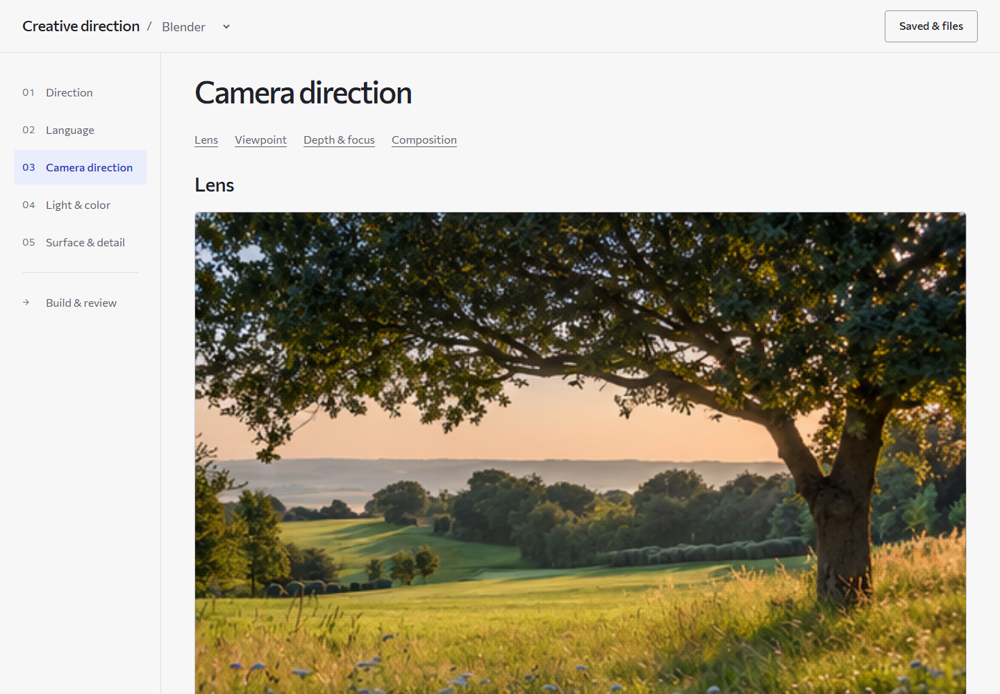

# Scuff

A local workspace and agent plugin for Blender, image generation and video generation. Start with the subject and Tone, choose visual decisions where useful, then hand actual references and resolved instructions to your connected agent.



## Start locally

Requires Node.js 20 or newer. The app has no runtime dependencies or API keys.

```sh
git clone https://github.com/vishalx0707/Scuff.git
cd Scuff
npm start
```

Open **http://127.0.0.1:8787** after the ready message. The launcher starts only the local server; it does not open a window. On Windows you can also use `Open Scuff.cmd`.

## Choose from an agent chat

The same local choice page works with Codex, Claude Code, Cursor and other local MCP-capable agents. The agent creates a session seeded from the conversation and opens or links its page. You choose, then use **Done** or **Ignore** in the page or the host's supported chat question. The agent receives the saved choices and resolved prompt without copy-paste. Choices in different chats use separate sessions. Ignore skips this step; it does not submit partial settings or cancel the original task.

The optional `agent-mcp.mjs` adapter provides `start_choices`, `read_choices`, `wait_choices`, `ask_choices` and `finish_choices`. Connect its local Node command using `mcp-config.example.json` in the intended host. Native form appearance depends on that host; unsupported clients fall back to their question tool or a normal reply. The adapter does not open a browser or run a model. The CLI fallback works without MCP registration. See [agent choice loop](skills/plan/references/agent-choice-loop.md) and [choice sessions](docs/AGENT-CHOICES.md).

Run `node server.mjs` (Node20+, no dependencies) and open **http://127.0.0.1:8787**. The server binds only to this computer. Keep it running. Use a background browser when requested; no launcher or browser popup is necessary.

## Work through a direction

1. Describe the subject, action and Tone on **Direction**. Optional panels hold time/weather, story contrast, scope, references, motion and comparisons.
2. Choose Camera, Language, Light & color or Surface & detail only where useful. New directions leave these choices unresolved. Advanced details remain folded; preset languages are optional starts.
3. On **Build & review**, use the concise four-part generator prompt or the full agent brief. Manual edits persist, and changed settings mark their drafts stale. Reconcile/regenerate stale drafts before queuing.
4. Upload actual image/audio references with their roles. **Queue build** saves a direction and real input files. Its waiting status means a connected agent must claim it; no AI runs automatically.
5. Ask your connected agent to execute the queued job using this folder's `SKILL.md` and `skills/direct/SKILL.md`. After it inspects actual outputs and reports a receipt, the page shows the result links, inspection and limitations. A job can fail visibly when a tool is unavailable.

Saved **Directions** restore whole-project snapshots. **Styles** transfer selected camera/light/finish treatment while keeping the new subject, action, identity references, journal and manual text. Extract a verified style from an approved image plus its original generating prompt; preserve unknown optical settings as hypotheses.

## Use with Codex or another connected agent

Read the root `SKILL.md`; it routes to plan, direct, references, shot, style and optional nature workflows. The site cannot read a chat or launch the agent. The agent needs its separately configured Blender MCP or image/video tool. Excluded collaborators must remain excluded.

```powershell
node compile.mjs direction.json prompt.md
node compile.mjs direction.json generator.md --generator
node compile.mjs direction.json style.json --style
node compile.mjs direction.json search-plan.md --references
node jobs.mjs list
node jobs.mjs claim <job-id> Codex
node jobs.mjs complete <job-id> result-receipt.json
node jobs.mjs fail <job-id> "Concrete limitation"
```

See [queued execution](skills/direct/references/queued-execution.md) for the exact receipt and [workflow notes](docs/WORKFLOW-0.3.md) for API behavior. The plugin is named `scuff`; `FIELDWORK_*` environment variables, the MCP example's `fieldwork` connection key, HTTP headers and local storage keys remain compatible with earlier local builds. No external collaborator is required to use the skills or CLI.

## Data and evidence

Directions/styles stay in this browser's local storage until exported. Uploaded references, queued directions and registered result copies live in `.fieldwork-local` beside the plugin. Export browser work before clearing storage. Keep `.fieldwork-local` out of shared ZIPs because it can contain private files.

The section-based example images remain locally bundled: eleven distinct Pinterest reference photographs fed 57 generated variants. One scene is reused within each section; different sections use different scenes. These are illustrative, not calibrated lens simulations. Sources/prompts/hashes remain in `docs/example-provenance.json` and `docs/EXAMPLES.md`.

See [asset credits and reuse limits](docs/ASSETS.md). Private uploads, chat history, source videos, research archives and local MCP configurations are excluded from this repository.

[CTLT source context](docs/CTLT-SOURCES.md) distinguishes video observations from our additions and inaccessible private materials. More detail, noise or resolution is not automatically better; inspect the actual result against the selected feeling, story and physical read.

## Verification

Run `npm test` for the Node suite. The Python helper tests require Python 3.10 or newer and run with `npm run test:python`. To install the optional browser testing dependency and run the complete local flow:

```sh
npm ci
npx playwright install chromium
npm run test:all
```

On Linux, use `npx playwright install --with-deps chromium` when system dependencies are missing. Browser tests need port 8787 to be free; stop a previous local server first. They start isolated stores, run headless, and write ignored outputs under `test-results/`. They do not use your normal browser profile or open visible windows.

Software tests cover semantics, import/export, reference bytes, exclusive job claims, choice-session isolation and verified artifact transport. They do not prove artistic quality or a live generator connection. Blender-specific diagnostics can be run separately with `blender --background --factory-startup --python tests/blender-smoke.py -- test-results/blender`. That command creates only its isolated diagnostic scene.

See [the verification record](docs/VERIFICATION.md) for current checks and their limits. GitHub Actions runs the Node, Python and headless browser suites on Windows and Linux.
